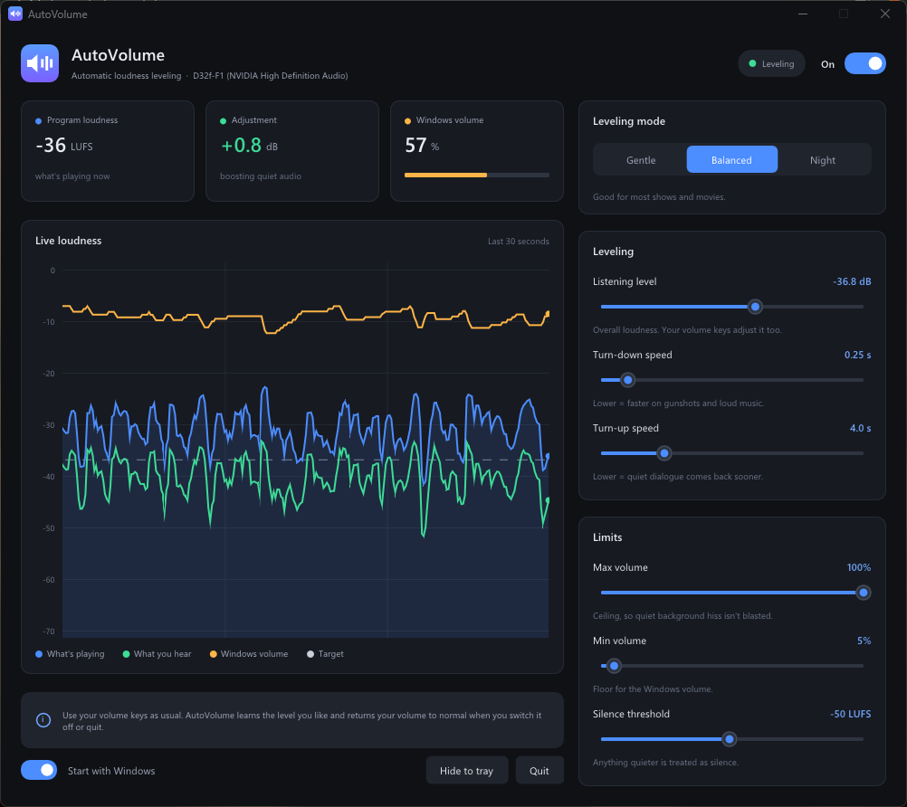
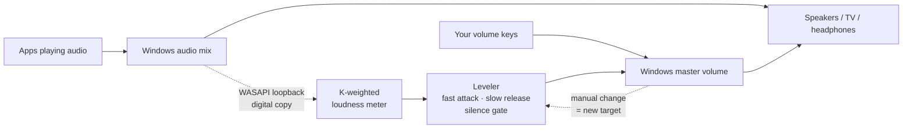

<div align="center">

# AutoVolume

**Automatic loudness leveling for Windows: quiet dialogue up, explosions down.**

[](#requirements)
[](#building-from-source)
[](https://github.com/ocornut/imgui)
[](LICENSE)



</div>

---

Movies and TV shows are mixed for cinemas: dialogue is quiet, while music, gunshots and explosions are
loud. At home that means sitting with the remote, turning it up to hear people talk and down when the
action starts.

**AutoVolume does that for you.** It listens to whatever your PC is playing, measures how loud it
actually sounds, and adjusts the Windows volume in real time. It needs no drivers, no audio routing
and no setup. It works with every app: browsers, Netflix, VLC, Plex, games and more.

## Features

- **Loudness-aware.** Measures perceived loudness with ITU-R BS.1770 K-weighting, the same standard
  broadcasters and streaming services use, rather than raw signal peaks.
- **Fast down, gentle up.** Turns loud scenes down within a fraction of a second, then brings
  dialogue back up smoothly without pumping.
- **Ignores silence.** Pauses between scenes are never boosted, so room noise doesn't get blasted.
- **Learns from your volume keys.** Press volume up or down as usual and AutoVolume adopts that as your
  new listening level.
- **Gives your volume back.** When you switch it off or quit, Windows returns to the volume you had.
- **Three modes plus fine control.** *Gentle*, *Balanced* and *Night* presets, plus sliders for
  listening level, reaction speeds, volume limits and the silence threshold.
- **Live loudness graph.** Shows what's playing, what you hear, the Windows volume and your target.
- **Stays out of the way.** Runs in the system tray, starts with Windows (optional), follows you
  when you switch outputs (speakers to headphones) and runs as a single instance.
- **Lightweight and native.** One self-contained ~1 MB `.exe`, C++20 with Dear ImGui on Direct3D 11.
  Near-zero CPU use.

## How it works



1. **Capture.** A [WASAPI loopback](https://learn.microsoft.com/windows/win32/coreaudio/loopback-recording)
   stream receives a digital copy of the default output device's mix. This is not your microphone,
   and nothing is recorded or saved.
2. **Measure.** Audio is K-weighted (BS.1770) and averaged over a short window (400 ms) to get
   momentary loudness in LUFS. Anything below the silence threshold is ignored.
3. **Smooth.** An envelope follower rises quickly when audio gets louder (*turn-down speed*) and
   falls slowly when it gets quieter (*turn-up speed*). After a big drop, such as an explosion
   followed by dialogue, it recovers faster at first, then eases in.
4. **Act.** It sets the Windows master volume so that *content loudness + volume = your
   listening level*, kept within your min/max volume limits. Each output device's volume curve is
   calibrated once, so percentages and decibels line up exactly.

## Requirements

- Windows 10 (1809 or later) or Windows 11, x64
- Any output device: speakers, headphones, HDMI TV, USB DAC and so on

## Installation

### Download

Grab `AutoVolume.exe` from the [Releases](../../releases) page, put it in any folder and run it.
There is no installer: settings are stored next to the exe.

### Building from source

You need **Visual Studio 2022 or newer** with the *Desktop development with C++* workload, and
**CMake 3.21+**.

```bash
git clone https://github.com/<your-username>/AutoVolume.git
```

```bash
cd AutoVolume
```

```bash
build.bat --shortcut
```

This builds `bin\AutoVolume.exe` (Release, static CRT), runs the unit tests and, with `--shortcut`,
puts a shortcut on your desktop. To build manually:

```bash
cmake -S . -B build -A x64
```

```bash
cmake --build build --config Release
```

```bash
ctest --test-dir build -C Release --output-on-failure
```

All dependencies are vendored in `third_party/`, so no package manager is needed.

## Usage

Run **AutoVolume** and start watching. That's it.

| Control | What it does |
| --- | --- |
| **On / Off switch** | Turns leveling on and off. Off returns your volume to normal. |
| **Leveling mode** | *Gentle*: subtle and slow, keeps dynamics. *Balanced*: the default. *Night*: strongest, keeps action close to dialogue level. |
| **Listening level** | How loud things end up. Your volume keys move this too. |
| **Turn-down speed** | How fast it reacts to sudden loud sounds. Lower is faster. |
| **Turn-up speed** | How quickly quiet dialogue comes back up. Lower is faster, but can "pump". |
| **Max / Min volume** | Limits on the Windows volume, so it never blasts hiss or goes silent. |
| **Silence threshold** | Anything quieter (in LUFS) counts as silence and is never boosted. |
| **Start with Windows** | Launches minimized to the tray at sign-in. |

Closing the window hides AutoVolume to the **system tray**. Right-click the tray icon to pause it,
open it or quit.

> [!TIP]
> **Don't run Windows at 100% volume.** At 100% AutoVolume can only turn things *down*. Set Windows
> to about 50% and turn your TV, amplifier or speakers up instead. That leaves headroom to boost
> quiet dialogue.

### Command-line options

| Option | Effect |
| --- | --- |
| `--minimized` | Start hidden in the tray (used by *Start with Windows*). |
| `--quit` | Tell a running AutoVolume to exit cleanly (it restores your volume). |
| `--install-shortcut` | Create a desktop shortcut, then exit. |

Running `AutoVolume.exe` while it's already running brings the existing window to the front.

### Settings file

Settings live in `settings.json` next to the executable. They're written automatically, and you
can delete the file to reset everything.

| Key | Default | Meaning |
| --- | --- | --- |
| `enabled` | `true` | Leveling on/off |
| `target` | *from your volume* | Listening level in dB (content LUFS + volume dB) |
| `max_pct` / `min_pct` | *from your volume* | Windows volume limits in % |
| `attack` | `0.25` | Turn-down time constant (s) |
| `release` | `4.0` | Turn-up time constant (s) |
| `window` | `0.4` | Loudness averaging window (s) |
| `gate` | `-50` | Silence threshold (LUFS) |
| `calibration` | *auto* | Per-device volume % to dB table |

## Limitations

- **Single sudden sounds.** AutoVolume controls the volume knob, so it reacts *after* a sound starts
  (within about 50 to 250 ms). A long loud scene is tamed almost immediately, but the first instant
  of a single surprise gunshot will still be loud. Removing that would need look-ahead processing
  inside the audio path (an APO or a virtual audio device), which AutoVolume deliberately avoids so
  it needs no drivers.
- **It affects everything.** Leveling applies to all audio on the device: games, music and calls
  too. Pause it from the tray when you don't want it.
- **Exclusive-mode apps** that bypass the Windows mixer can't be measured.

## Troubleshooting

| Problem | Fix |
| --- | --- |
| Volume never goes up | Windows is probably at 100% or *Max volume* is low. See the tip above. |
| Background noise gets loud in quiet scenes | Lower *Max volume* or raise *Silence threshold*. |
| Volume "pumps" up and down | Choose *Gentle*, or raise *Turn-up speed*. |
| Loud scenes aren't tamed fast enough | Choose *Night*, or lower *Turn-down speed*. |
| Something else is wrong | Check `autovolume.log` next to the exe. |

## Project structure

```
AutoVolume/
├── src/
│   ├── main.cpp         Window, Direct3D 11, tray, main loop, command line
│   ├── ui.cpp/.h        Dear ImGui interface and custom widgets
│   ├── engine.cpp/.h    WASAPI loopback capture and volume control thread
│   ├── loudness.h       BS.1770 K-weighting and the leveling controller (no OS deps)
│   ├── settings.cpp/.h  settings.json load/save
│   ├── platform.cpp/.h  Single instance, shortcuts, tray icon, dark title bar
│   └── log.cpp/.h       Small rotating file logger
├── tests/tests.cpp      Unit tests for the meter and controller
├── res/                 Icons, version info, DPI-aware manifest
├── third_party/         Dear ImGui 1.92.9b, nlohmann/json 3.12.0
├── docs/                Screenshot
├── CMakeLists.txt
└── build.bat
```

## Contributing

Issues and pull requests are welcome. Please keep changes focused, match the existing code style,
and make sure `ctest` passes. Changes to the leveling behaviour should come with a test in
`tests/tests.cpp`.

## Acknowledgements

- [Dear ImGui](https://github.com/ocornut/imgui) by Omar Cornut and contributors (MIT)
- [nlohmann/json](https://github.com/nlohmann/json) by Niels Lohmann (MIT)
- [ITU-R BS.1770](https://www.itu.int/rec/R-REC-BS.1770) loudness measurement

## License

AutoVolume is released under the [MIT License](LICENSE). Third-party components keep their own
licenses, found in `third_party/`.
